<h2 align="center">
    Welcome to My Profile! 
    
</h2>

    
      
    

 

### ✨ About Me

- 🎓 **Education:** M.Sc. in Computer Science at **Sharif University of Technology** | B.Sc. from **University of Tehran**
- 🛡️ **Research Focus:** Cryptography (Secure Multi-Party Computation, Lattice Encryption) & Theoretical CS
- 🔗 **Website:** [mrmotabar.github.io](https://mrmotabar.github.io)

---

<h2> ⚡ Activity & Stats </h2>

  

   
  
  &nbsp;
  
   

<b>Note:</b> <em>Top languages is only a metric of the languages my public code consists of and doesn't reflect experience or skill level.</em>

---

<h2> 🛠️ &nbsp;Tech Stack & Tools </h2>

     &nbsp;
     &nbsp;
     &nbsp;
     &nbsp;
     &nbsp;
     &nbsp;
     &nbsp;
     &nbsp;
     &nbsp;
     &nbsp;
     &nbsp;
     &nbsp;
     &nbsp;
     &nbsp;
     &nbsp;
     &nbsp;
     &nbsp;
     &nbsp;
     &nbsp;
     &nbsp;
     &nbsp;
    

---

<h2> 💬 &nbsp;Connect with Me </h2>

  
  
  

